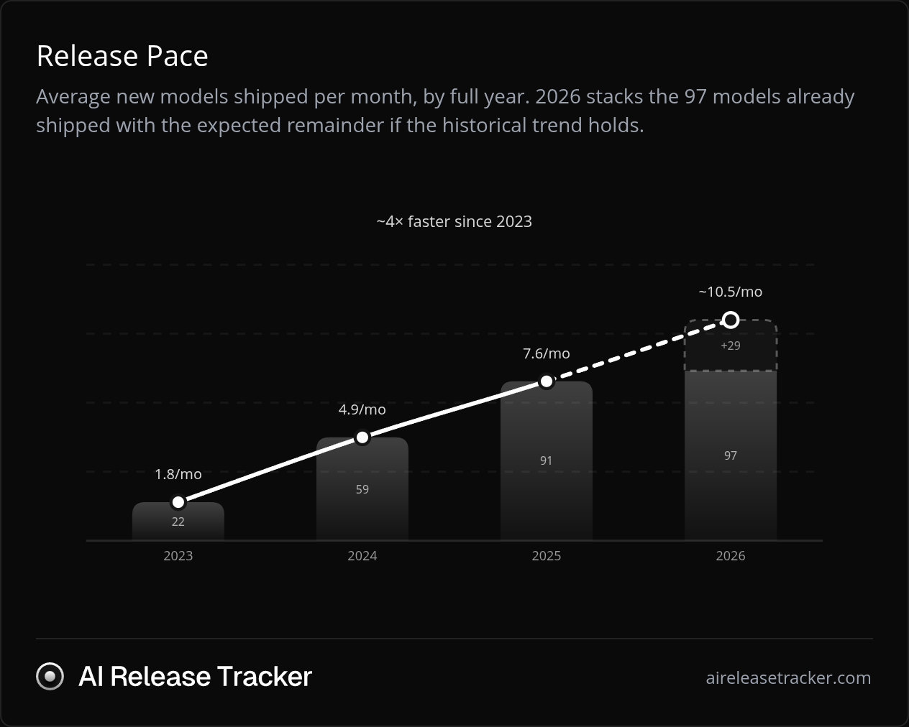
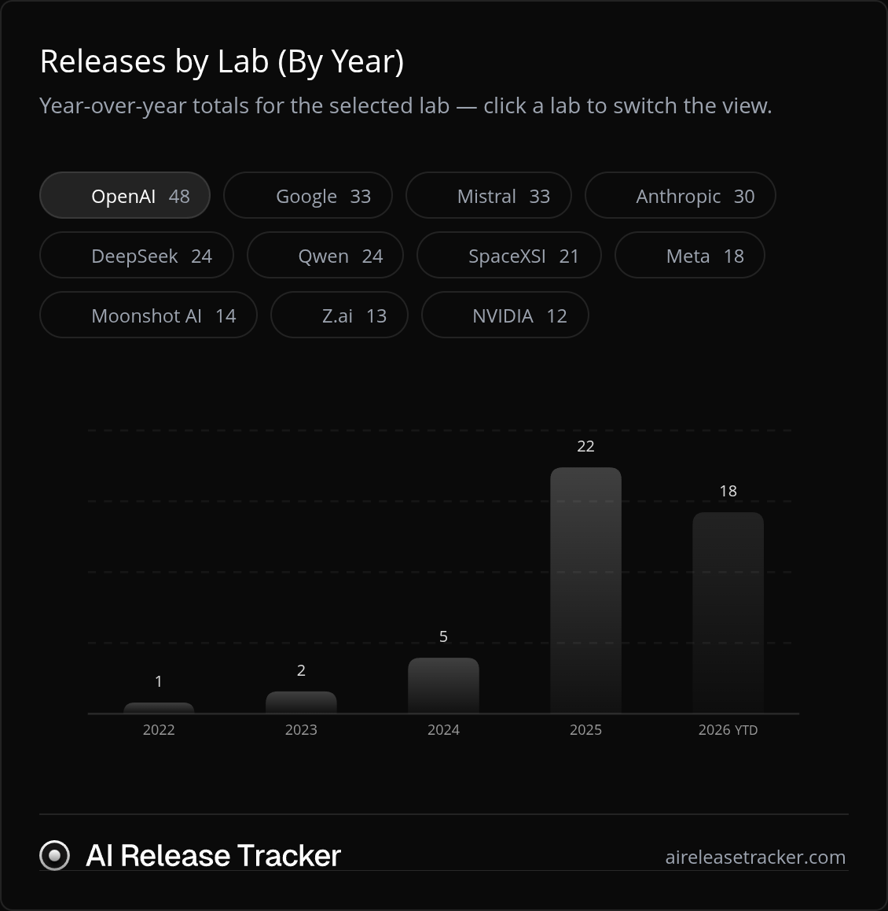
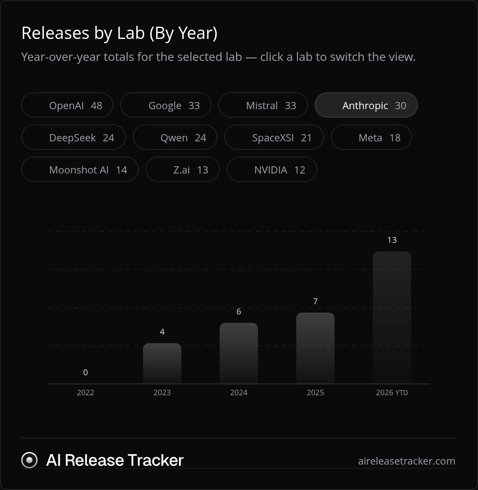

## Observation: GPT 6.1 Sol vs Opus 5.5{{note: Date as of writing: Nov 9, 2026}} {{note: This is not a technical exposition of AI models}}

As are most things with relation to time - I'm but stating the obvious here: 
> #### _Humans are unbelievably notorious for normalizing notions that were just recently extremely polarizing_

LLMs have started making strides in human ingenuity in solving problems - Maths, Science, and dear lord _coding!_
But this hasn't been happening for more than a couple of years.

A fantastic timeline is available at [AiReleaseTracker](https://aireleasetracker.com/analytics)

> [!TIP] 
> Click to expand a few quick charts by them (for me to ground what I'm talking about):
> 

>     
AI labs and their releases

> 
> |  | 
> |:--:| 
> | *Release pace of models (by multiple labs)* |
> 
> ### OpenAI releases
> |  | 
> |:--:| 
> | *Release pace of models (by OpenAI)* |
> 
> ### Anthropic releases
> |  | 
> |:--:| 
> | *Release pace of models (by Anthropic)* |
> 

### Humans - Normalizing crazy extremes

**Humans are instinctively very adaptable to situations.**

I've said this jokingly - That while most animals give birth to offsprings that can literally start walking right after being birthed - Its us humans who need a lot of nurturing and love before we can become _good enough_ to even function on our own. And I've always attributed this to one feature that I've observed - that what humans have lacked during this gestational period is offset by one of our interesting traits - _Endurance._ That humans can _endure_ crazy things during their lifetime - and they have the adaptability that's crazy good compared to most animals.{{note: Of course, this isn't scientifically spoken about. I'm trying to establish my thought process}} 

And I've started adding _adaptability_ to that statement.

And what better goes alongside that adaptability as correlation? _Normalization_{{note: I'm talking in terms of sociology. Defined as [_Normalization refers to social processes through which ideas and actions come to be seen as 'normal' and become taken-for-granted or 'natural' in everyday life_](https://en.wikipedia.org/wiki/Normalization_(sociology))}}

We were surprised how good ChatGPT was when it released. And just a couple of years later - We can build things that took literally years and hundreds if not thousands of people working on it through varying degrees of difficulty - more than half of which can't be certain!{{note: Like economic situation, crazy leadership, personal grievences of employees and colleagues, inspirations and pivots striking from randomest of situations to the C-level people reorganizing what so many people were working on for months if not for years, layoffs, hiring spree, etc}}

And today - at the time of writing, the frontier labs have Opus 5.5 and Sol6.1/Astra as their highest performing models.{{note: I'm not talking about benchmarks here. Performance can be measured from different directions - financially profitable, token-efficient, task-efficient, intelligence scale, etc. (Hence why I used Sol/Astra)}}

And here comes the normalization part of this post:
- I've been recently seeing people bashing OpenAI that their models are bad (especially the latest at the time of writing - On Sol 6.1), and that they should be working on better models rather than giving free resets. (Note that those are all the same people who agreed to the subscriptions' terms, and these free resets from Tibo are just an added bonus)
- Just before Opus 5.5 released - We were all just enjoying how efficient Sol 6.1 was and how cheaper it was on the smartness vs cost scale compared to the previous generation models. 
- Opus 5.5 has been very efficient, intelligent, and overall the best model (by many people's usage and utility) at the time of writing. Which is just a couple of months since either of their releases. 

Literally a couple of years ago - We didn't know this was possible at all. Or atleast we didn't expect the breakneck speed of artificial intelligences explosion as it is right now. And yet - We're incredibly normalized to this kind of incredible technological advancement. 

More so than what's happening with OpenAI and their models, (or Anthropic for that matter) - its just fascinating to me that we are this quick to accept something as normal. Perhaps we've been too ignorant to how much us humans have evolved to treat something new - We just get used to it, and that it becomes normal to us. Perhaps this is why we're destined for the stars. It'll not stop here - Every new thing - Everything that hasn't been attempted before will be attempted, and we'll push the goal post further and further away.

Is it not prudent to be more observant? Is it not fascinating that we've come so far? In chasing and hustling to something better - Is it not incredibly important to appreciate the present as we go along? As a wise saying goes - 

> He who can't be happy with what he has, can never be happy with what he'll get

In the pursuit of intelligent machines - It seems we're increasingly becoming impatient, kindless, and rude to humans first. And talking to LLMs is only going to aggravate it.{{note: When interacting with LLMs: I don't have any reinforcement on what's right and wrong - How I should speak/convey things when I talk to an LLM. Human interaction isn't just verbal communication, it's the non-verbal cues. Worse yet - Sycophancy is making people more deluded}}

Not saying we shouldn't be more curious, or that we shouldn't be trying for improvement on what we already have - I'm not saying we should just be content with what we have and stop pursuing things - I'm just wondering that it'd only help us see things more clearly and intuitively if only we just paid attention to what we have and appreciate it before we can actually find ways of improving it. 

Or perhaps I'm just lazy and not hustling hard enough.
